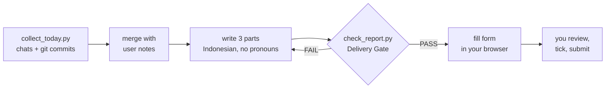

<div align="center">

# maganghub-autofill

**Your MagangHub daily report, drafted from real work. You submit it.**

An agent skill for [MagangHub Monev](https://monev.maganghub.kemnaker.go.id) (Kemnaker, Indonesia's government internship program). It reads today's agent chats and git commits, writes the three report parts in Indonesian with no first-person perspective, then fills them into the form in your browser.

[Before and after](#before-and-after) · [How it works](#how-it-works) · [Install](#install) · [Usage](#usage) · [Rules](#rules) · [Limits](#limits)


</div>

---

The skill is written in English. **The report it produces is always Indonesian.**

> [!IMPORTANT]
> Only you submit the form. The skill fills the three textareas and stops: it never ticks the confirmation checkbox and never clicks **Simpan dan Kirim**. Submitting also records attendance.

## Before and after

Evidence: 3 commits and one prompt about a rejected token.

| Before (no skill) | After |
|:--|:--|
| Hari ini saya sangat senang bisa belajar banyak hal baru yang luar biasa. Saya membuat fitur dengan sempurna dan semua berjalan lancar. Semoga hari esok lebih baik! | **Uraian aktivitas** <br>- Membuat endpoint login berbasis JWT. <br>- Menulis tes unit untuk validasi token. <br>- Memperbaiki urutan middleware yang menolak token valid. |

More in [`examples.md`](skills/maganghub-autofill/references/examples.md).

## How it works



| Part | What it does |
|---|---|
| **Real evidence** | `collect_today.py` gathers Claude Code and omp chat prompts plus git commits for one date |
| **Writing rules** | 14 ID'd rules (`W-xx`): no fabrication, no "saya/kami", no empty vocabulary, no em dash |
| **Delivery Gate** | `check_report.py` checks 100 characters per part, pronouns, meta tags, em dash, bullet and paragraph shape |
| **Form fill** | Through the agent's browser tool, on the Monev portal. Login and submit stay with you |

## Install

### Symlink (user-level, Claude Code and omp)

```bash
./install.sh
```

Links into `~/.claude/skills/` and `~/.omp/agent/skills/`.

### Plugin

```text
/plugin marketplace add raditsoic/maganghub-autofill
/plugin install maganghub-autofill@maganghub-autofill
```

```bash
omp plugin marketplace add raditsoic/maganghub-autofill
omp plugin install maganghub-autofill@maganghub-autofill
```

> [!NOTE]
> The plugin commands are untested; the manifests follow the marketplace format of a reference project.

### Browser setup (omp with Brave or Chrome)

The fill step drives your already logged-in browser through the omp relay.

```bash
omp browser-relay install
```

1. Open `brave://extensions` (or `chrome://extensions`) and enable **Developer mode**.
2. **Load unpacked** and select `~/.omp/browser-relay/extension`. With WSL: `\\wsl.localhost\<distro>\home\<user>\.omp\browser-relay\extension`.
3. Log in once at `https://monev.maganghub.kemnaker.go.id/dashboard/evaluasi` in that browser.

Quirks and details: [`form.md`](skills/maganghub-autofill/references/form.md).

## Usage

```text
/maganghub-autofill
/maganghub-autofill add: meeting with mentor about API design; struggle: slow staging access
/maganghub-autofill no-ask
```

Notes can be in any language; the report is written in Indonesian.

**No-ask mode** (`/maganghub-autofill no-ask`) never asks a question: it decides from the chats and commits alone, fills the form, and lists the decisions it made so you can correct them. With no evidence at all it stops instead of inventing a report. It still never ticks the checkbox or submits.

After the skill fills the form: **review the three fields → tick the confirmation checkbox → Simpan dan Kirim.**

## Rules

| ID | Rule |
|---|---|
| W-01 | Facts only from evidence or user notes |
| W-02 | Struggles must be real; none found → the skill asks you |
| W-10 | No person perspective (saya, aku, kami, kita, penulis, Anda) |
| W-30 | Activities as 3-5 bullets of major outcomes only; lessons and struggles as one paragraph each |
| W-32 | Every part at least 100 characters (form validation) |
| W-50 | Form text is report content only |

All 14 rules with before/after samples: [`writing-rules.md`](skills/maganghub-autofill/references/writing-rules.md).

## Layout

```text
skills/maganghub-autofill/
├── SKILL.md                    workflow
├── references/
│   ├── writing-rules.md        W-xx rules with before/after
│   ├── examples.md             example reports
│   └── form.md                 the form and browser procedure
└── scripts/
    ├── collect_today.py        collect evidence
    └── check_report.py         Delivery Gate
```

## Limits

- Verified once, on 2026-11-06 with omp and Brave through the relay: the form was filled and read back correctly. Submitting was not exercised. The portal can change; `references/form.md` describes the flow as seen on that date.
- Chat history is read from `~/.claude/projects` and `~/.omp/agent/sessions`. Other agents are not supported.

## Releasing

Versions follow [SemVer](https://semver.org/); changes are listed in [CHANGELOG.md](CHANGELOG.md).

1. Add entries under `## [Unreleased]` in `CHANGELOG.md` as you work.
2. Run `scripts/release.sh <version>`. It bumps `.claude-plugin/plugin.json` and both `marketplace.json` files, rolls the changelog, commits `chore(release): vX.Y.Z`, and tags `vX.Y.Z`.
3. Run `git push origin main --follow-tags`. The `release` workflow checks that the tag matches the manifests and creates the GitHub release from the changelog section.

Users update with `omp plugin upgrade maganghub-autofill@maganghub-autofill`.

## License

Code and docs: MIT — see LICENSE.